# RTAL MiniAmused: Technischer Vergleich des Ladder-Filters mit Arturia Mini V

### Spektralanalyse mit weißem Rauschen · Fehlerdiagnose · DSP-Korrektur · Validierung durch Messung und Hörtest

**Real Time Audio Lab (RTAL) · RTAL MiniAmused · Technischer Untersuchungsbericht · 11. Oktober 2026**  
**Untersuchte Firmware:** MiniAmused **v1.2.6 FINAL** (stabile Referenz) und **v1.2.7 DEV1 – Ladder Cutoff Range Fix** (experimenteller Entwicklungsstand).  
**Externe Vergleichsreferenz:** **Arturia Mini V**, eine *Softwareemulation* des Minimoog – **kein gemessener analoger Original-Minimoog**.

> **Kurzfazit:** Die Messreihe hat eine reale Begrenzung in der CUTOFF-Berechnung des MiniAmused sichtbar gemacht. Der bis dahin verwendete LUT-Helfer begrenzte den angeforderten Filter-CUTOFF bei **5.120 Hz**, obwohl die Bedienoberfläche Werte bis **20 kHz** anzeigte. Eine gezielte Änderung in `cutoffFromNorm()` erweitert die Sollwertberechnung. Die nachfolgenden FFT-Messungen belegen einen erheblich weiter geöffneten Hochtonbereich und eine mit der Grenzfrequenz wandernde Resonanz. Der Entwickler bestätigt den Unterschied bei offenen Sägezahnklängen auch **hörbar**. Die v1.2.6 FINAL bleibt unverändert; DEV1 ist ein untersuchter, aber noch nicht als FINAL veröffentlichter Entwicklungsstand.

**Navigation:** [Zielsetzung](#1-zielsetzung) · [Messverfahren](#2-messverfahren-und-einschränkungen) · [Arturia-Referenz](#3-arturia-mini-v--referenzmessungen) · [v1.2.6](#4-miniamused-v126-final--ausgangszustand) · [Codeursache](#5-die-entscheidende-fehlerursache-im-quellcode) · [DEV1](#6-messungen-nach-der-korrektur) · [Gesamtvergleich](#7-gesamtergebnisse-und-interpretation) · [Folgerungen](#8-folgerungen-für-die-entwicklung) · [Messarchiv](#anhang-a--vollständiges-messarchiv)

---

## 1. Zielsetzung

Der **RTAL MiniAmused** ist ein eigenständiger, auf dem ESP32-S3 realisierter Synthesizer. Die Klangerzeugung besitzt einen vierstufigen nichtlinearen Ladder-artigen Tiefpass mit Resonanzrückkopplung, zweifachem Oversampling und einer resonanzabhängigen Pegel-/Body-Kompensation. Die Kompensation wurde im stabilen Entwicklungszweig klanglich abgestimmt.

Die Untersuchung sollte **nicht** nachweisen, dass MiniAmused ein analoges Originalinstrument identisch nachbildet. Stattdessen sollten folgende Fragen anhand nachvollziehbarer Messungen beantwortet werden:

1. Wie verschieben CUTOFF und EMPHASIS den Frequenzgang und die Resonanzspitze der **Arturia-Mini-V-Referenz**?
2. Wie verhält sich das eigene Ladder-Filter bei gleichen *Reglerwerten* – und wo unterscheiden sich die Ergebnisse?
3. Erreicht MiniAmused tatsächlich den auf dem Display dargestellten maximalen CUTOFF-Bereich?
4. Wie weit lässt sich der auffällige Unterschied durch eine **isolierte Softwareänderung** beheben, ohne die bewährte Ladder-Architektur umzubauen?
5. Stimmen die FFT-Beobachtungen mit dem praktischen Höreindruck überein?

**Abgrenzung:** Ein identischer Reglerwert `CUTOFF = 64` ist bei zwei verschiedenen Synthesizern **keine Zusicherung identischer physikalischer Filterfrequenz**. Die Arturia-Messung ist eine Vergleichsreferenz für das Verhalten einer konkreten Softwareemulation, keine normative Spezifikation eines analogen Moog-Filters.

## 2. Messverfahren und Einschränkungen

### 2.1 Signal und Instrumenteneinstellungen

| Messgröße | Arturia Mini V | RTAL MiniAmused |
|---|---|---|
| Filter-Anregung | **interner WHITE-NOISE-Generator** | **interner WHITE-NOISE-Generator** |
| Oszillatoren | OSC 1–3 ausgeschaltet | OSC 1–3 stumm |
| Filterhüllkurve | CONTOUR = 0 | CONTOUR = 0 |
| Geänderte Größen | CUTOFF / EMPHASIS | CUTOFF / EMPHASIS |
| Weitere Filtermodulation | nicht verwendet | KEY TRACK OFF, FILTER MOD OFF |
| Drive / zusätzliche Rückkopplung | für den Vergleich möglichst neutral | DRIVE 0, Mixer-FEEDBACK 0 |
| Delay / Effekte | nicht Teil der Filteruntersuchung | DELAY OFF |
| Audio | Softwareemulation, interner Signalweg | ESP32-S3 / I2S, 48 kHz, 128 Frames, 2× Filter-Oversampling |
| Spektraldaten | FFT-Screenshots | FFT-Screenshots |

Die Messreihe wurde mit aufeinanderfolgenden FFT-Screenshots dokumentiert. Für MiniAmused wurde die Lautstärkehüllkurve während der Aufnahme konstant gehalten; beide Geräte wurden mit weißem Rauschen angeregt. Die gespeicherten Bilder besitzen eine logarithmische Frequenzachse und eine dB-Darstellung.

### 2.2 Was man aus den Bildern ableiten kann – und was nicht

Die Grafiken zeigen **Ausgangsspektren**. Formal gilt für ein ideales *lineares* zeitinvariantes System bei Leistungsspektren:

\[
S_{\mathrm{out}}(f)=|H(f)|^2\,S_{\mathrm{in}}(f).
\]

Eine tatsächliche Übertragungsfunktion `H(f)` erhielte man erst durch Bezug auf das jeweilige **gemessene Eingangsspektrum**. Hier stammen die Rauschsignale aus **zwei unterschiedlichen internen Generatoren**; außerdem enthalten die Signalwege ggf. weitere frequenzabhängige Stufen. Die Ladder-Filter sind nichtlinear, sodass die lineare Formel nur eine Orientierung darstellt. Deshalb gelten die folgenden Grenzen:

- **Gut belegbar:** qualitativ andere Höhenöffnung, sichtbare Resonanzentwicklung, Verschiebung von Peaks und der **im Quellcode nachweisbare LUT-Grenzfehler**.
- **Nur näherungsweise ablesbar:** Resonanzfrequenzen, Beginn eines Höhenabfalls und relative Pegelveränderungen.
- **Nicht seriös allein aus Screenshots bestimmbar:** exakte −3-dB-CUTOFF-Frequenz, kalibrierte 24-dB/Oktave-Steilheit, RMS-/THD-Werte, Aliasing-Anteile oder eine präzise Basskompensation in dB.
- **Nicht belegt:** vollständige Gleichheit oder Ungleichheit zum originalen analogen Minimoog; dafür wäre ein entsprechend kalibrierter Hardwarevergleich nötig.

Einige Bereiche der Messkurven liegen bereits nahe dem angezeigten **Rausch-/Messboden**. Deren feine Struktur sollte nicht als Filterdetail interpretiert werden. Rohdaten der FFT, exakte Fensterung, Mittelung, Pegelkalibrierung und Eingangsrauschspektren lagen für diesen Bericht **nicht** vor. Daher werden keine erfundenen dB- oder Gütefaktorwerte angegeben.

**Messumfang:** 10 Arturia-Bilder, 11 MiniAmused-v1.2.6-Bilder und 14 DEV1-Bilder = **35 dokumentierte FFT-Aufnahmen**. Sämtliche Original-Screenshots liegen unverändert unter [`filter_assets/originals/`](filter_assets/originals/); die Übersicht steht in [`measurement_index.csv`](measurement_index.csv).

## 3. Arturia Mini V – Referenzmessungen

### 3.1 Vollständige Parametermatrix

| CUTOFF | EMPHASIS | Anzahl Bilder | Schwerpunkt |
|---:|---|---:|---|
| 0 | 0 / 64 / 127 | 3 | geschlossener Filter, tieffrequente Resonanz |
| 64 | 0 / 64 / 96 / 127 | 4 | Resonanzwachstum im mittleren Reglerbereich |
| 127 | 0 / 64 / 127 | 3 | weit geöffneter Filter, oberer Hochtonbereich |

#### A. CUTOFF = 0

Bei minimaler Stellung dominiert eine sehr starke Höhenunterdrückung. Mit steigender EMPHASIS bildet sich eine erkennbare tieffrequente Überhöhung; in der Aufnahme mit EMPHASIS 127 liegt ihr sichtbar hervorgehobener Bereich **grob bei 60–70 Hz**. Da das Eingangsspektrum nicht separat bestimmt wurde, bezeichnet dies die **Lage eines Peaks im Ausgangsspektrum**, nicht eine kalibrierte −3-dB-Grenzfrequenz.

<details>
<summary><strong>FFT-Serie ansehen: Arturia, CUTOFF 0</strong></summary>

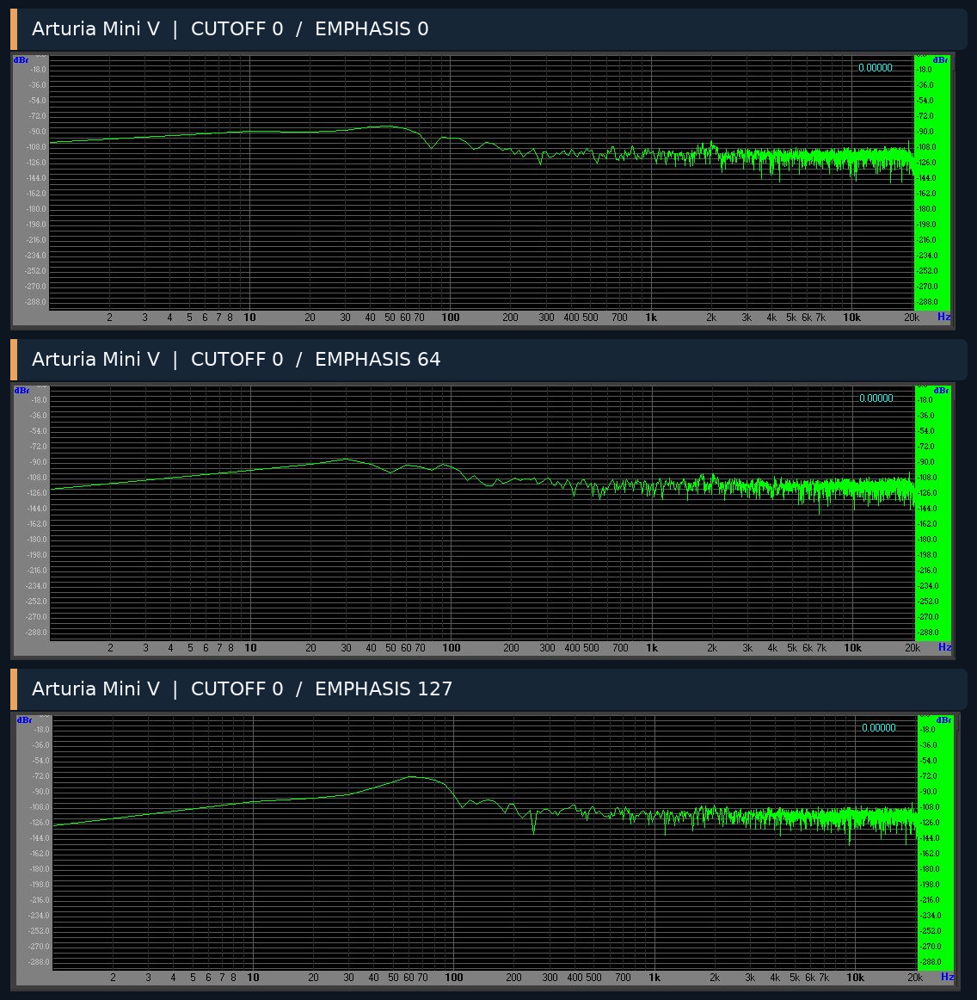

</details>

#### B. CUTOFF = 64

Der Filter zeigt einen breiten Durchlass-/Übergangsbereich. Bei höherer EMPHASIS formt sich eine zunehmend markante Resonanzspitze; bei EMPHASIS 96 und 127 ist sie **grob um 2 kHz** lokalisiert. Deutlich ist außerdem, dass eine höhere Resonanz nicht bloß eine zusätzliche Spitze auf ein ansonsten unverändertes Ausgangsspektrum setzt: Die gesamte Pegelverteilung wandelt sich.

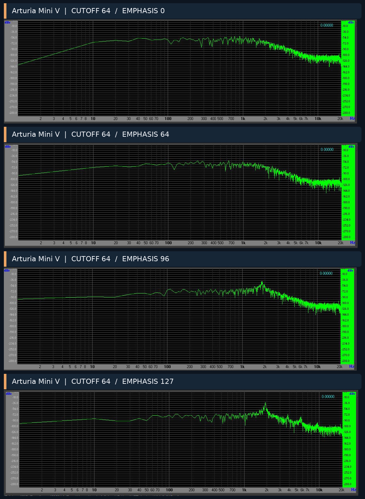

#### C. CUTOFF = 127

Bei EMPHASIS 0 reicht das Rauschspektrum weit in die Höhen. Mit maximaler EMPHASIS entsteht eine kräftige Hochfrequenzüberhöhung nahe dem oberen Rand des dargestellten Hörbereichs. Ihre exakte Lage und Ursache bleiben unbestimmt: Die verwendete Emulation, ihr Oversampling, das Ausgangsfilter und die FFT-Bedingungen können das Ergebnis mitprägen.

<details>
<summary><strong>FFT-Serie ansehen: Arturia, CUTOFF 127</strong></summary>

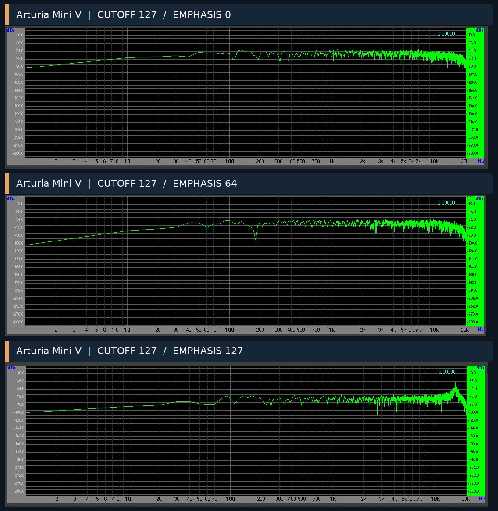

</details>

**Referenzbefund:** Arturia Mini V verbindet eine stark CUTOFF-abhängige Peak-Lage mit einem ausgeprägten Resonanzeinfluss auf den übrigen Frequenzgang. Die gezeigte Darstellung ist für unseren Vergleich hilfreich, aber kein allgemeingültiges Messbild eines analogen Ladder-Filters.

## 4. MiniAmused v1.2.6 FINAL – Ausgangszustand

### 4.1 Messmatrix

| CUTOFF | Angezeigte Frequenz | EMPHASIS-Aufnahmen |
|---:|---|---|
| 0 | ca. 20 Hz | 0, 64, 127 |
| 64 | ca. 615 Hz | 0, 32, 64, 112, 127 |
| 127 | 20 kHz (Display) | 0, 64, 127 |

### 4.2 Mittlerer CUTOFF-Bereich: funktionierende Resonanz

Bei `CUTOFF = 64` liegt die auffällige Resonanz im groben Bereich von **550–650 Hz**. Von EMPHASIS 0 über 32 und 64 bis 112 und 127 wird die Anhebung klarer. Dieser Verlauf belegt qualitativ, dass die selbst entwickelte nichtlineare Ladder-Rückkopplung bei mittlerem CUTOFF sinnvoll auf EMPHASIS reagiert.

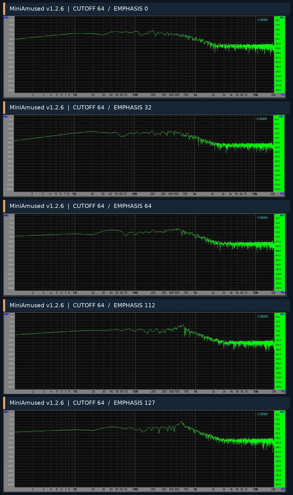

**Wichtig beim Vergleich:** Beim Arturia Mini V liegt bei *demselben Reglerwert* `CUTOFF = 64` die starke Resonanzspitze deutlich höher (grob um 2 kHz). Das belegt in erster Linie **unterschiedliche Regler-zu-Frequenz-Kennlinien beziehungsweise Gesamtimplementierungen**. Es wäre falsch, daraus allein eine grundsätzlich schlechtere Resonanz des MiniAmused abzuleiten.

<details>
<summary><strong>Direkte Gegenüberstellung bei gleichen Reglerwerten – bewusst nicht frequenzkalibriert</strong></summary>

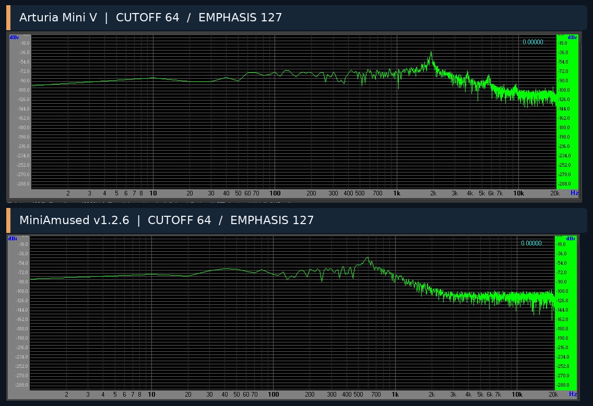

</details>

### 4.3 Oberer CUTOFF-Bereich: auffällige Höhenbegrenzung

Obwohl das Display bei `CUTOFF = 127` **20 kHz** zeigte, ließ v1.2.6 schon ab einigen Kilohertz erheblich weniger hochfrequente Rauschanteile durch. Die Resonanz erschien bei maximaler EMPHASIS ebenfalls wesentlich tiefer als es die Anzeige vermuten ließ. Genau diese Diskrepanz motivierte die anschließende Quellcodeanalyse.

<details>
<summary><strong>FFT-Serie ansehen: MiniAmused v1.2.6, CUTOFF 127</strong></summary>

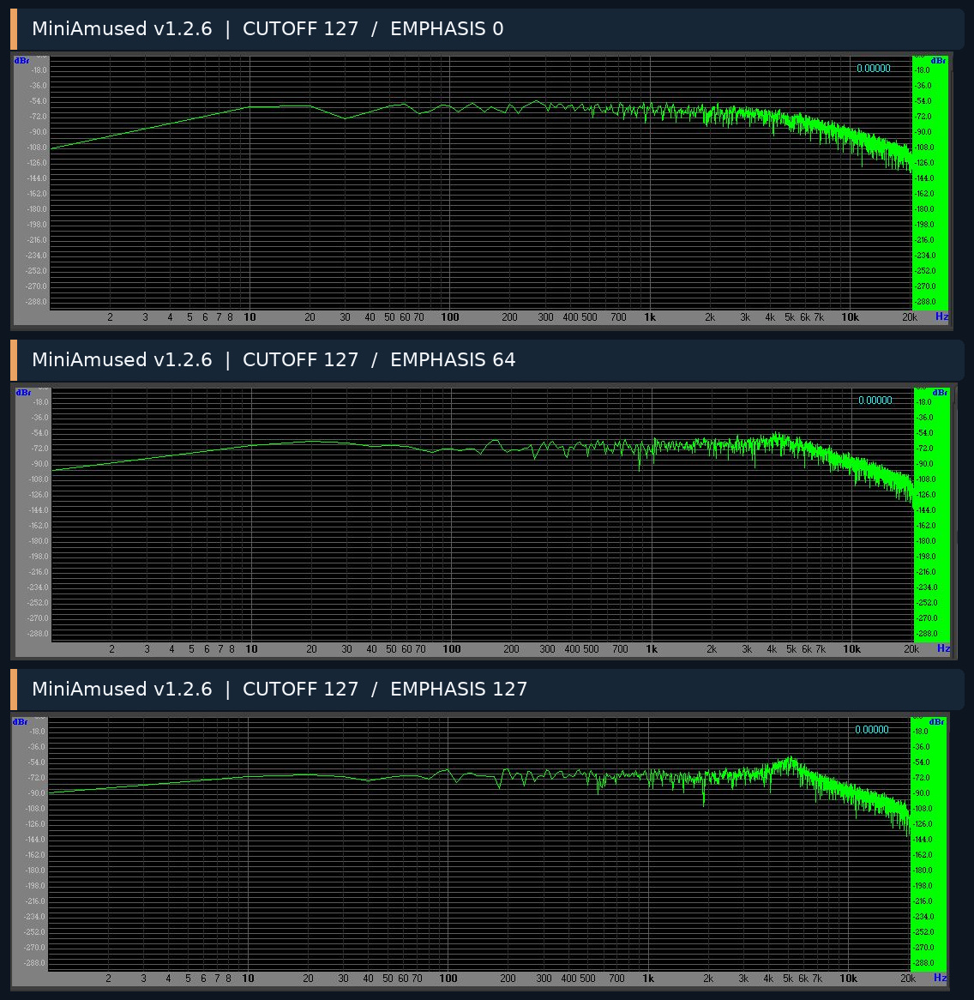

</details>

### 4.4 Minimaler CUTOFF

Bei `CUTOFF = 0` ist das Signal stark gedämpft. Die deutliche tieffrequente Resonanzüberhöhung der Arturia-Reihe ist unter den vorliegenden Bedingungen nicht gleichermaßen sichtbar. Ob dies an unterschiedlicher minimaler Filterfrequenz, Rückkopplungsabstimmung oder den jeweiligen Mess-/Rauschbedingungen liegt, bleibt offen. Dafür wurde **keine** separate Filterkorrektur vorgenommen.

<details>
<summary><strong>FFT-Serie ansehen: MiniAmused v1.2.6, CUTOFF 0</strong></summary>

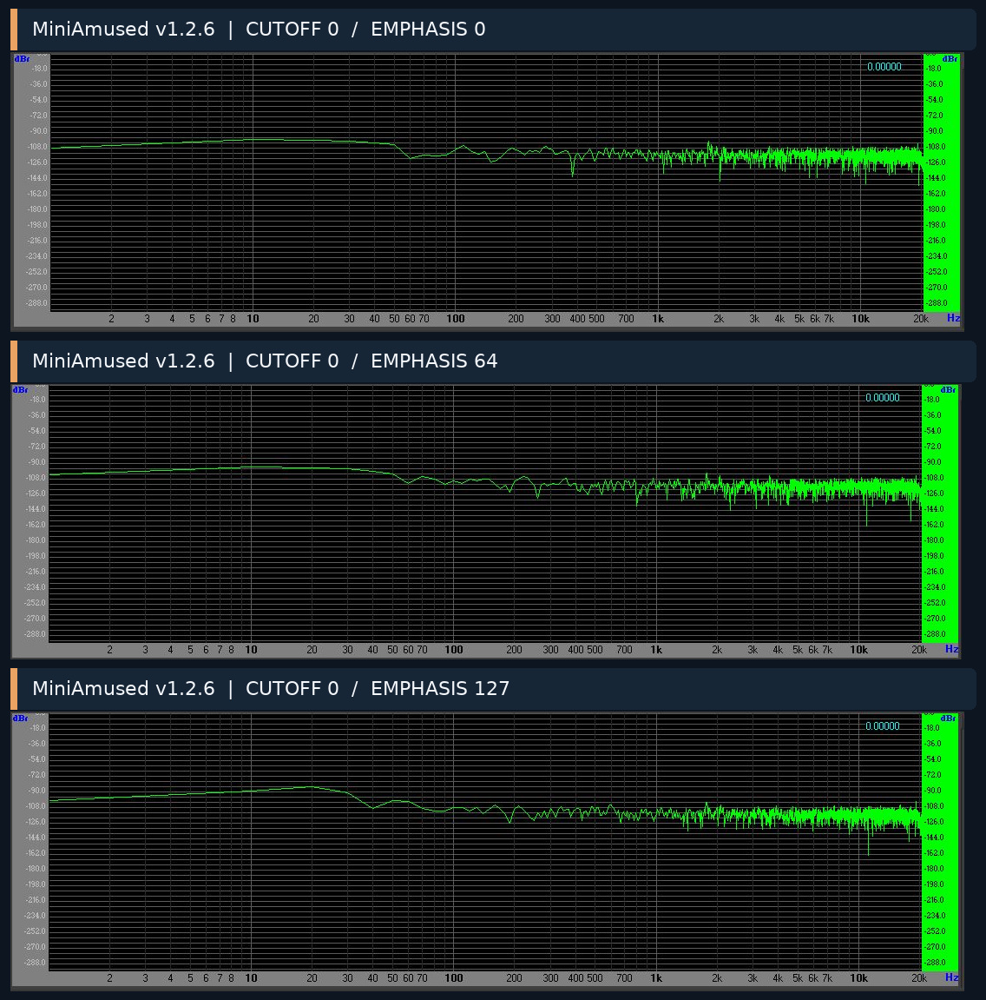

</details>

## 5. Die entscheidende Fehlerursache im Quellcode

### 5.1 Logarithmische Sollwertberechnung

In `SynthEngine.cpp` wird der normierte CUTOFF-Wert `n` (`0 … 1`) theoretisch wie folgt in Hertz umgesetzt:

```text
fc(n) = 20 Hz × 2^(9,965784 × n)
```

Damit sollen sich bei `n = 0` ungefähr **20 Hz** und bei `n = 1` ungefähr **20.000 Hz** ergeben.

Der bisherige Code in **v1.2.6** verwendete:

```cpp
static inline float cutoffFromNorm(float n)
{
    return 20.0f * fastExp2(9.965784f * n);
}
```

`fastExp2()` ist ein schneller, aus einer Tabelle interpolierender Helfer. Die Tabelle deckt ausschließlich die Exponenten **−8 bis +8** ab. Größere Werte werden auf **+8** begrenzt. Daraus ergibt sich zwingend:

```text
fc_max = 20 × 2^8 = 20 × 256 = 5.120 Hz
```

Die Sättigung beginnt rechnerisch ungefähr bei `n = 8 / 9,965784 ≈ 0,803` – also bei **rund 80 % des normierten CUTOFF-Regelbereichs**. Die Displayanzeige verwendete hingegen eine davon getrennte logarithmische Frequenzberechnung und konnte weiterhin **20 kHz** darstellen.

**Wichtig:** Dieser Befund ist keine Vermutung aus Screenshots. Er ergibt sich **direkt aus den tatsächlichen Funktionen im Quellcode** und erklärt den charakteristischen Hochtonabfall der v1.2.6.

### 5.2 Kleine, isolierte Korrektur in DEV1

Die Firmware enthielt bereits einen erweiterten LUT-Helfer `fastExp2Envelope()`, der den Exponentenbereich durch Bereichszerlegung abdeckt. DEV1 verwendet diesen vorhandenen Helfer **nur für die Basis-CUTOFF-Berechnung**:

```diff
 static inline float cutoffFromNorm(float n)
 {
-    return 20.0f * fastExp2(9.965784f * n);
+    return 20.0f * fastExp2Envelope(9.965784f * n);
 }
```

Damit liefert die Sollwertberechnung theoretisch wieder den gesamten Bereich **20 Hz bis 20 kHz**, ohne zusätzliche `powf()`- oder `expf()`-Aufrufe im zeitkritischen DSP-Pfad.

**Keine Veränderung** erfolgte an den vier nichtlinearen Polstufen, der globalen Resonanzrückkopplung, dem 2× Oversampling, den Hüllkurven, dem Mixer oder der Basskompensation.

### 5.3 Die zweite, unabhängige Schutzbegrenzung

Die interne Funktion `ladderG()` begrenzt `cutoffHz` separat auf **18.000 Hz**, bevor der Filterkoeffizient berechnet wird. Daher darf man die Angabe „20 kHz“ **nicht** mit einer tatsächlich gemessenen −3-dB-Frequenz von 20 kHz gleichsetzen. Die digitale Ladder-Diskretisierung und die verwendete Koeffizientenformel wirken ebenfalls auf die reale Übertragung.

| Größe | v1.2.6 FINAL | v1.2.7 DEV1 |
|---|---|---|
| Angezeigter maximaler CUTOFF | 20 kHz | 20 kHz |
| Basis-CUTOFF aus `cutoffFromNorm()` | auf **5.120 Hz begrenzt** | bis **20.000 Hz** berechenbar |
| Schutzgrenze in `ladderG()` | 18 kHz (praktisch vorher nicht erreicht) | **18 kHz** (weiterhin wirksam) |
| Ladder-Struktur und Resonanzgesetz | unverändert | **unverändert** |
| Bass-/Body-Kompensation | unverändert | **unverändert** |
| Messbefund bei geöffnetem Filter | deutliche Höhenabsenkung | erheblich breiteres Ausgangsspektrum |

## 6. Messungen nach der Korrektur

### 6.1 DEV1: CUTOFF = 127, EMPHASIS = 0 – der wichtigste Vorher/Nachher-Test

Die beiden untenstehenden Bilder wurden mit offenem Filterregler und deaktivierter Resonanz erstellt. **v1.2.6** zeigt eine ausgeprägte Höhenunterdrückung; **DEV1** lässt das Rauschspektrum über einen erheblich größeren Teil des Hörbereichs passieren.

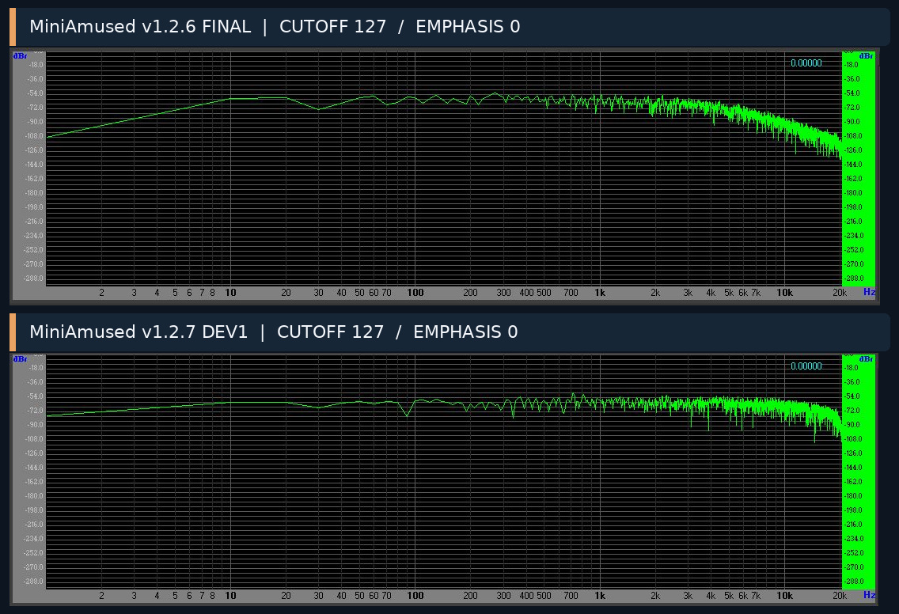

**Ergebnis:** Der Hochtonbereich öffnet sich genau in der erwarteten Richtung. Zusammen mit dem nachgewiesenen Codefehler liefert das eine **starke, miteinander übereinstimmende Evidenz** für die Wirksamkeit des Cutoff Range Fix. Eine genaue −3-dB-Frequenz wurde nicht bestimmt.

Die erste DEV1-Serie enthielt ebenfalls Aufnahmen bei CUTOFF 64, 96, 102 und 110. Beim Übermitteln der Bilder waren **zwei Grafiken vertauscht**; der Messende hat diese Zuordnungsfrage ausdrücklich geklärt. Zur Vermeidung falscher numerischer Zuschreibungen stützen sich die zentralen Schlussfolgerungen deshalb auf die **eindeutig zuordenbaren** Vorher/Nachher- und Resonanzserien. Alle Originaldateien sind im Archiv erhalten.

### 6.2 DEV1: Resonanzentwicklung um 7,5–8 kHz

Bei der als ungefähr **7,51 kHz** angezeigten hohen CUTOFF-Stellung (`CUTOFF = 110`) wurde EMPHASIS über `0 → 64 → 96 → 127` erhöht. Die Resonanz wächst sichtbar und bildet bei maximaler EMPHASIS eine markante Überhöhung grob im **8-kHz-Bereich**. Oberhalb der Überhöhung folgt wieder ein Abfall.

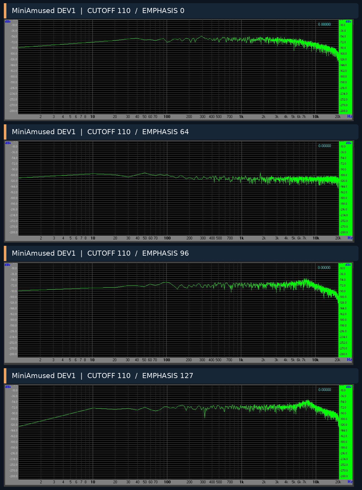

**Ergebnis:** DEV1 verbessert nicht nur die Durchlässigkeit des Filters. Auch die **resonante Rückkopplung** reagiert nun im zuvor praktisch abgeschnittenen Frequenzbereich.

### 6.3 DEV1: Resonanz-Sweep bis an die obere Bandgrenze

Mit **EMPHASIS = 127** wurden vier weitere CUTOFF-Stellungen aufgenommen:

| CUTOFF-Regler | Angezeigte Frequenz laut Bilddatei | Qualitativer FFT-Befund |
|---:|---:|---|
| 114 | 9,34 kHz | Resonanzüberhöhung im Bereich um 9–10 kHz |
| 118 | 12,26 kHz | Peak bewegt sich ungefähr in den Bereich 12–13 kHz |
| 122 | 15,24 kHz | Peak wandert weiter in den oberen Hochtonbereich |
| 125 | 17,94 kHz | Spitze am oberen Auswerterand nicht mehr vollständig/eindeutig sichtbar |

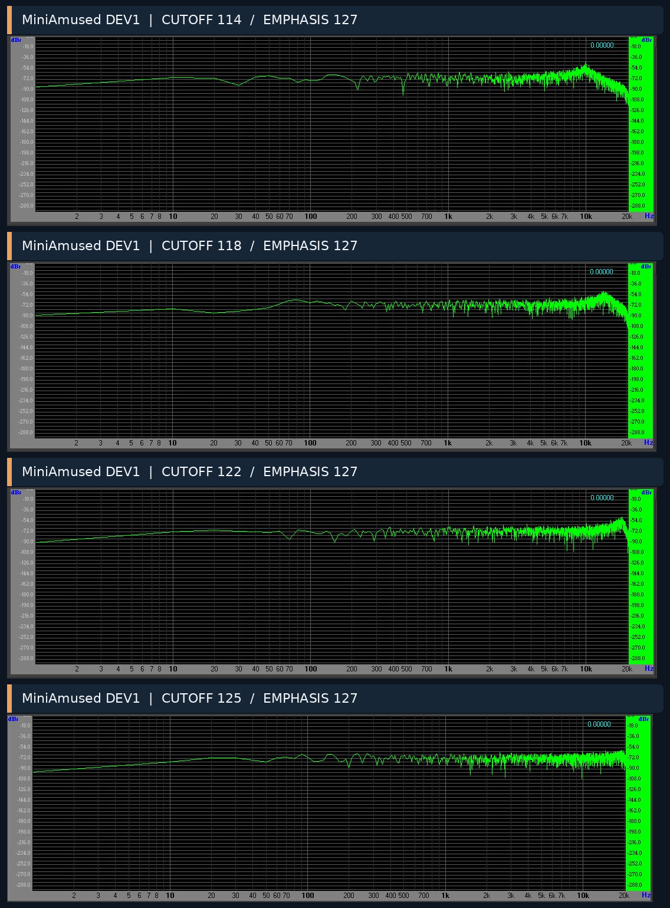

**Ergebnis:** Die Resonanzüberhöhung wandert im Messfenster **qualitativ monoton nach oben**. Bei den höchsten Stellungen nähert sie sich dem oberen Messbereich und dem Bereich, in dem die digitale Filterdiskretisierung und die Ausgabe-Abtastrate die Beobachtung stärker beeinflussen können. Die FFT-Bilder **beweisen weder** das Verschwinden der Resonanz **noch** das Auftreten von Aliasing oder Instabilität.

### 6.4 CUTOFF = 127 und zunehmende EMPHASIS

Bei vollständig geöffnetem Regler bleibt das Spektrum mit EMPHASIS 0, 64 und 127 vergleichsweise weit geöffnet. Anders als beim Arturia Mini V erscheint im letzten Screenshot **keine ebenso schmale und kräftige Resonanzspitze** innerhalb des sichtbaren Frequenzfensters.

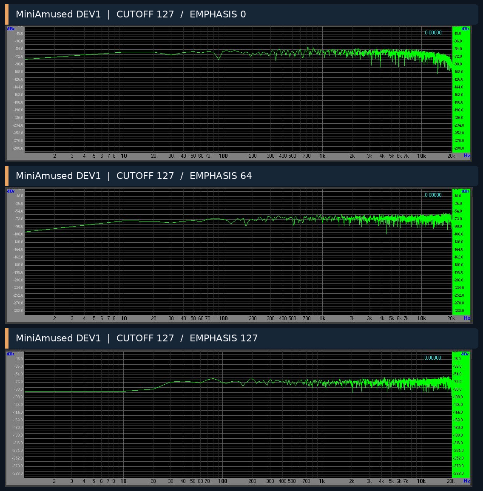

Diese Differenz ist **kein hinreichender Beleg** für einen Fehler. Unter anderem kommen eine verschobene Peak-Frequenz, die 18-kHz-Koeffizientengrenze, die Eigenheiten der digitalen Ladder-Integrationsformel und die spektrale Messauflösung als Erklärungen infrage. Eine zusätzliche Verstärkung am obersten Frequenzrand war **nicht Gegenstand** von DEV1 und wird aus den vorliegenden Ergebnissen nicht empfohlen.

<details>
<summary><strong>Optischer Arturia-/DEV1-Vergleich bei Reglerstellung CUTOFF 127, EMPHASIS 127</strong></summary>

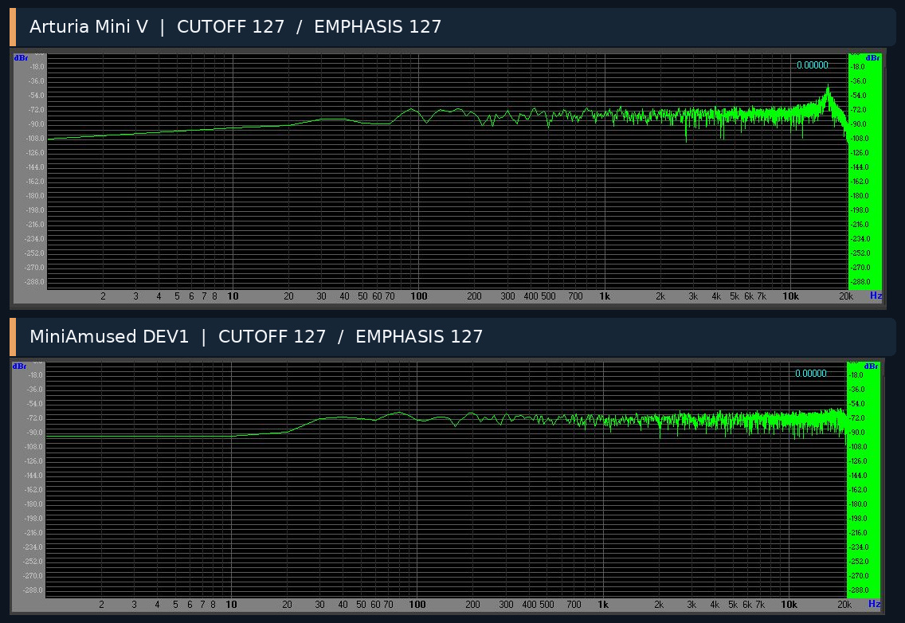

</details>

### 6.5 Praxistest mit Oszillatoren

Nach der Messserie erfolgte ein direkter Hörvergleich. Der Entwickler bestätigte bei **vollständig geöffnetem Filter**, insbesondere mit einer **Sägezahnwelle**, einen **klar hörbar brillanteren, offeneren Klang** von DEV1 gegenüber v1.2.6.

Dieser Hörbefund ist eine **subjektive, aber unmittelbar relevante Anwenderbeobachtung**. Er entspricht der Richtung der gemessenen spektralen Änderung und war das praktische Abschlusskriterium für den isolierten CUTOFF-Test.

## 7. Gesamtergebnisse und Interpretation

| Fragestellung | Befund | Evidenzgrad |
|---|---|---|
| Ursache für die frühe Höhenbegrenzung in v1.2.6 | `fastExp2()` begrenzt das Ausgangsargument oberhalb Exponent +8; Basis-CUTOFF endet bei 5.120 Hz | **Quellcode, eindeutig** |
| Wirksamkeit des DEV1-Fix | CUTOFF-Sollwert nicht mehr bei 5.120 Hz begrenzt; deutlich offeneres Spektrum | **Code + FFT, deutlich** |
| Filter arbeitet oberhalb 5 kHz resonant | Bei CUTOFF um 7–15 kHz wächst und wandert der Resonanzpeak | **FFT, qualitativ deutlich** |
| Exakte obere −3-dB-Grenze | Ohne Eingangsspektrum und numerische Kurven nicht bestimmt | **Offen** |
| Verifikation von 24 dB/Oktave | Screenshots alleine erlauben keine genaue, kalibrierte Steilheitsmessung | **Offen** |
| Basskompensation | Im aktuellen Code aktiv; nicht verändert; exakter dB-Effekt aus Bildmaterial nicht quantifiziert | **Quellcode ja, Messgröße offen** |
| Gleiche Kennlinie wie Arturia | Schon gleiche Reglerwerte entsprechen unterschiedlichen Resonanzfrequenzen | **Nicht gegeben** |
| Hörbarer Nutzen | Entwickler hört bei offenem Filter mehr Brillanz | **Subjektiver Hardware-Hörtest, bestätigt** |
| DEV1 Release-Status | Entwicklungsversion, kein offiziell festgeschriebener FINAL-Stand | **Projektstatus** |

### 7.1 Resonanz und Basskompensation

Eine klassische Ladder-Rückkopplung kann bei größerer Resonanz den Pegel außerhalb des Resonanzbereichs beeinflussen. MiniAmused besitzt deshalb seit dem stabilen Stand eine **resonanzabhängige Verstärkung innerhalb des nichtlinearen Filtereingangs** – **keine Dry-Bypass-Mischung**. Vereinfacht entspricht die implementierte Body-Kennlinie:

```cpp
const float bassComp = (r > 0.20f) ? (r - 0.20f) : 0.0f;
const float body = 1.0f + 0.08f * r
                 + 1.15f * bassComp
                 + 0.35f * bassComp * bassComp;
```

`r` bezeichnet den normierten Resonanzwert. Das Gesetz beeinflusst bei größerer Resonanz die **Ansteuerung der nichtlinearen Ladder**, nicht isoliert eine feste Bassfrequenz. Aus den gezeigten Ausgangsspektren kann man deshalb **nicht** den isolierten Bass-Gewinn in dB ableiten. Weil DEV1 lediglich den Exponentenhelfer austauschte, ist es technisch sinnvoll, diese bewährte Kennlinie **zunächst unverändert** zu belassen.

### 7.2 Verhalten oberhalb 15 kHz

Für die interne Filterberechnung gelten 2× Oversampling und die Frequenzschutzgrenze von 18 kHz; das ausgegebene Audiosignal läuft weiterhin mit **48 kHz**. Beim Erreichen des oberen Hörbereichs sind die numerische Frequenzabbildung, die Grenzfrequenzbegrenzung und das Downsampling relevant. Im Quellcode erfolgt die Rückführung aus dem zweifach oversampelten Pfad mit einem **einfachen Mittel zweier Samples**; ein aufwendiges Halfband-Antialiasing-Filter ist dort nicht implementiert. Das ist ein möglicher Forschungsansatz für spätere Entwicklungen, aber **aus der vorliegenden FFT-Serie wurde kein Aliasproblem nachgewiesen**.

Die Entscheidung, die Resonanz bei maximaler Frequenz **nicht künstlich zu verstärken**, ist daher bewusst vorsichtig und technisch begründet.

### 7.3 Welche Vergleiche sind fair?

Ein Vergleich *gleicher Reglerzahlen* untersucht vor allem die **Bedienkennlinie und Instrumentenwirkung**. Für einen wirklich filterbezogenen Vergleich müsste die **physikalische Resonanz-/Grenzfrequenz angeglichen**, derselbe breitbandige Stimulus durch die jeweiligen Filter geleitet, der Gain-Pfad kalibriert und das Spektrum vor bzw. nach den Filtern getrennt erfasst werden. Diese Bedingungen waren in der dokumentierten Messreihe nicht erfüllt. Daher verwenden wir die Arturia-Kurven zur **Orientierung**, nicht als unveränderliches DSP-Ziel.

## 8. Folgerungen für die Entwicklung

1. **Fehler diagnostiziert, nicht umgangen.** Der wichtigste Befund ist die numerische Sättigung der Exponential-LUT, nicht eine vermeintlich unzureichende Vierpol-Ladder-Topologie.
2. **Minimalinvasive Korrektur erfolgreich.** Der Austausch eines einzelnen Helferaufrufs verbessert den Hochton-Regelbereich nachweislich. Kein Neuabgleich von Filterstufen, Resonanz oder Hüllkurven war dafür nötig.
3. **Klangqualität profitiert.** Der Entwickler bestätigt nach der FFT-Validierung die hörbare Brillanzsteigerung bei geöffnetem Filter.
4. **Resonanz bleibt im erweiterten Bereich nutzbar.** Die Peaks wandern von ungefähr 8 kHz bis in den obersten Hochtonbereich. Eine schmale 20-kHz-Spitze ist **kein** notwendiges Optimierungsziel.
5. **Bass-/Body-Kompensation vorerst beibehalten.** Ihre exakte Wirkung wurde in diesem Versuch nicht separat quantifiziert; ein Eingriff wäre ohne zusätzliche Daten nicht gerechtfertigt.
6. **Arturia nicht blind kopieren.** Mini V ist eine sinnvolle Referenzemulation; das selbstständige RTAL-Instrument darf eine eigenständige Regelkennlinie und Klangabstimmung behalten.
7. **Stabile Basis schützen.** **RTAL MiniAmused v1.2.6 FINAL** bleibt der veröffentlichte, bewährte Referenzstand. **v1.2.7 DEV1** dokumentiert ausschließlich den untersuchten Cutoff-Range-Fix. Über einen offiziellen Folgerelease wird separat entschieden.

### Abschließendes Urteil

Die Untersuchung erfüllte ihr Ziel. Aus einer scheinbaren klanglichen Abweichung zur Arturia-Referenz wurde durch eine Kombination aus **reproduzierbaren FFT-Aufnahmen**, **Quellcodeanalyse**, **isolierter Korrektur**, **erneuter Messung** und **Hörtest** ein konkreter Entwicklungsfortschritt.

**Gesichert:** Die CUTOFF-LUT-Sättigung in v1.2.6 und ihre Beseitigung in DEV1 sowie die deutliche Verbesserung der Höhenöffnung.  
**Gut belegt:** Die bis in den hohen Frequenzbereich wandernde Resonanz und der subjektiv bestätigte Klanggewinn.  
**Nicht beansprucht:** vollständige analoge Authentizität, ein kalibrierter 24-dB/Oktave-Nachweis, exakte −3-dB-Werte oder gemessene Aliasing-/THD-Kennzahlen.

> **Engineering lesson:** Ein korrekt wirkender Displaywert ist kein Beleg für einen korrekt angewendeten DSP-Wert. Der Abgleich von Benutzeroberfläche, mathematischer Parameterkennlinie, tatsächlicher Signalverarbeitung und realer Messung ist entscheidend.

---

## Anhang A – Vollständiges Messarchiv

Alle **35 unveränderten Originalaufnahmen** sind in [`filter_assets/originals/`](filter_assets/originals/) enthalten. Jede Aufnahme ist mit Plattform, CUTOFF und EMPHASIS versehen; die vollständige Dateiliste und deren ursprüngliche Upload-Namen stehen in **[`measurement_index.csv`](measurement_index.csv)**.

| Datenreihe | Parameter | Anzahl |
|---|---|---:|
| **Arturia Mini V** | CUT 0: EMP 0/64/127 · CUT 64: EMP 0/64/96/127 · CUT 127: EMP 0/64/127 | 10 |
| **MiniAmused v1.2.6 FINAL** | CUT 0: EMP 0/64/127 · CUT 64: EMP 0/32/64/112/127 · CUT 127: EMP 0/64/127 | 11 |
| **MiniAmused v1.2.7 DEV1** | CUT 64/96/102/110/127: EMP 0 · CUT 110: EMP 64/96/127 · CUT 127: EMP 64/127 · CUT 114/118/122/125: EMP 127 | 14 |
| **Gesamt** | | **35** |

Die im Bericht verwendeten gestalteten Abbildungsserien sind nur **Zusammenstellungen der unveränderten Originalgrafiken mit hinzugefügten Beschriftungszeilen**. Es wurden keine Frequenzkurven künstlich geändert oder synthetische Messergebnisse eingefügt.

## Anhang B – Quellcodebezug und Reproduzierbarkeit

Der Softwarevergleich bezieht sich auf die untersuchten Firmwarearchive:

- `RTAL_MINIAMUSED_1_2_6_FINAL.zip` – unveränderte stabile Basis.
- `RTAL_MINIAMUSED_1_2_7_DEV1_LADDER_CUTOFF_RANGE_FIX.zip` – experimenteller Entwicklungszweig.

Wesentliche Quellcodestellen in `SynthEngine.cpp`:

- `fastExp2()` – LUT-Interpolation und Begrenzung auf Exponenten −8 … +8.
- `fastExp2Envelope()` – erweiterter Exponentenbereich ohne neue teure Funktionen im Renderpfad.
- `cutoffFromNorm()` – **einzige funktionale Änderung** für den hier untersuchten Fix.
- `ladderG()` – eigenständige 18-kHz-Schutzbegrenzung und digitale Filterkoeffizienten.
- `Ladder::process()` – vier nichtlineare Stufen, globale Resonanzrückkopplung und Body-Kompensation.

**Hinweis für GitHub:** Dieses Dokument und den kompletten Ordner `filter_assets/` gemeinsam unter `docs/technical/` ablegen, damit alle Abbildungsverweise funktionieren. Die v1.2.6 bleibt bis zu einer gesonderten Freigabe der offizielle stabile Stand.

---

*© 2026 Real Time Audio Lab · RTAL MiniAmused · Technischer Untersuchungsbericht. Arturia Mini V dient ausschließlich als benannte Vergleichsreferenz; keine Zugehörigkeit oder offizielle Unterstützung durch Arturia oder Moog.*
